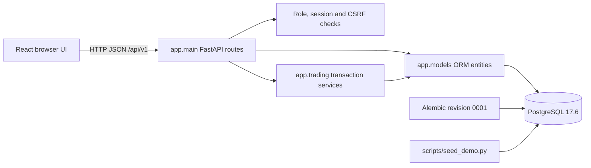
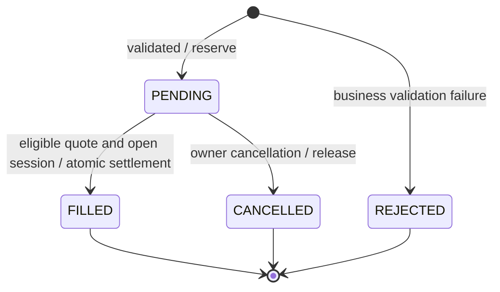
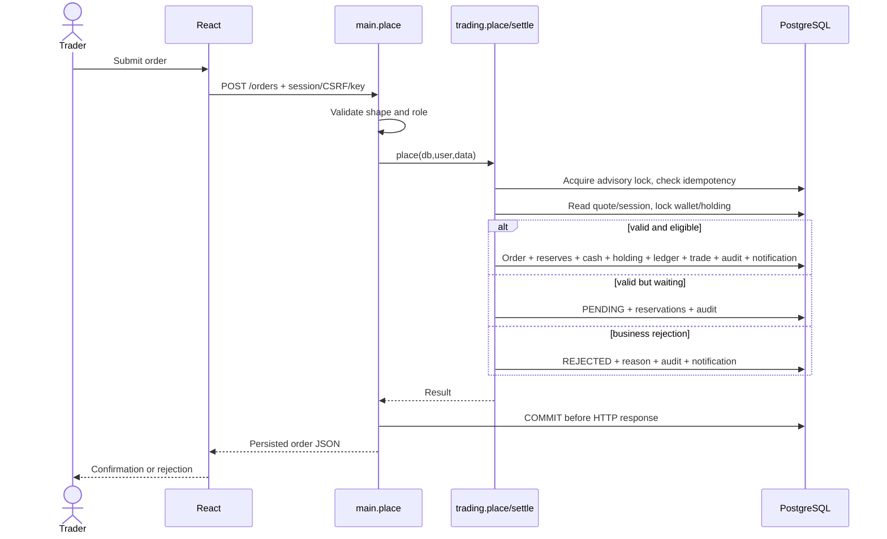
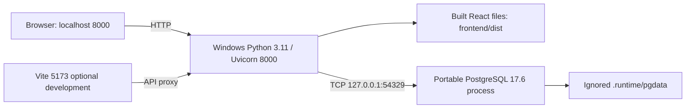

# As-built system reference

Status: implemented local prototype, 16 November 2026. This is source material for lab work, not a completed experiment report. See decision_log.md for scope and evidence/ for observed results.

## Problem, actors and boundaries

TradeSphere models an order's entire lifecycle rather than storing a simple share transaction list. It connects user identity, virtual cash, outstanding reservations, execution, holdings, valuation and auditable history. The guest registers/logs in; the trader owns trading data; the admin governs accounts and catalog; the operator controls synthetic prices/session. There is no broker, exchange, payment service or external feed.

## Architecture and module responsibilities

The modular monolith consists of `main.py` (API/auth/query boundary), `trading.py` (financial workflows), `models.py` (persistent entities) and `db.py` (configuration/transaction lifecycle). The frontend's App orchestrates role-specific screens; Table, Badge and Chart are shared components. There is no separate scheduler/execution worker or repository interface abstraction. All quote-triggered fills happen synchronously within the operator request. GET requests refresh on navigation or explicit refresh.

## Data flows and structure-chart source

Context inputs/outputs:

| External actor | Input data | Output data |
|---|---|---|
| Guest | Email/password registration or login | Safe profile/session or validation error |
| Trader | Order request, cancel ID, watchlist membership, read marker, filters | Orders, trade receipts, balances, holdings/P&L, alerts/history |
| Administrator | Instrument metadata/status, user status, audit query | Catalog, safe user directory, aggregate counts, audit events |
| Market operator | Stock ID/price/event key, open/closed state | Quote event, session status, price history |

Level-1 process/data-store map:

| Process | Reads | Writes | Output |
|---|---|---|---|
| Identity & access | users/auth_sessions | users/auth_sessions, initial portfolio/wallet/ledger, favorites, audit | session/profile |
| Market | stocks/price_ticks/market_sessions | stocks or ticks/session history, audit | catalog/quotes/status |
| Order/risk | users, stocks, latest tick/session, wallet/holdings, existing orders | orders, reservations, audit, notifications | pending/rejected/filled order |
| Settlement | pending orders, ticks/session, wallet/holdings | trades, wallet/ledger, holdings, order, audit, notification | execution receipt |
| Portfolio/reporting | wallet, holdings, ticks, orders/trades/ledger | none | derived P&L, histories |
| Watchlists/alerts | own memberships/notifications | owned watchlist/item/read marker | list/status |
| Governance | users, catalog, audits, aggregate counts | account/catalog status, associated pending cancellations | safe directory/audit/summary |

Order Level-2: authenticate owner -> compare idempotency payload -> validate instrument/quote/session/quantity -> check available resources -> reserve -> record order -> eligible? -> settle atomically or retain pending. Validation failure writes a rejected business order and notice without cash movement. Cancellation authenticates owner, locks, checks PENDING, releases reservations and persists CANCELLED once.

Structure chart: App UI -> api helper -> main routes -> current/role and db_session -> trading.place/cancel/process_pending -> wallet_for/holding_for/quote/eligible -> settle -> record/notify and ORM. Reporting routes compute from database facts. There are no invented service classes or external notification services.

## Data model

See schema.md for complete types, nullability, PK/FK/unique/check constraints; schema.sql is generated PostgreSQL DDL. ER relationships and attributes are also in schema.md. Schema source is frozen revision `0001`, plus models.py for ORM mapping. `AuthSession` is the additional technical entity beyond the original conceptual inventory.

A registered trader owns one portfolio and one wallet. Admin/operator identities own none. This makes User-to-Portfolio participation optional globally but mandatory in the public trader-registration transaction. Trade has one unique order; pending/rejected/cancelled orders have no trade. Zero-quantity holdings may remain to retain accumulated realized P&L. No physical-delete APIs exist.

## Order state and business rules

CREATED/VALIDATED are conceptual stages, not persisted states. Immediate market/eligible-limit requests pass through PENDING in the same transaction, returning FILLED. Malformed shape/auth/unknown-symbol failures are API errors, not persisted rejected orders. If execution fails, rollback restores pre-request state. A failure during a quote request rolls back that quote and every fill in that transaction.

Limit trigger sequence: operator -> POST ticks -> lock_market -> unique event-key check -> append PriceTick -> process_pending -> check active user/instrument, open session, usable quote, price condition -> settle -> commit -> return. Reopen uses the same pending processor across all stocks.

Communication diagram source numbering: 1 Trader submits; 1.1 UI POST; 1.2 API current/role; 1.3 trading.place; 1.3.1 advisory lock/idempotency; 1.3.2 quote/risk; 1.3.3 reserve; 1.3.4 settle; 1.3.4.1 wallet/holding/ledger/trade; 1.3.4.2 audit/notification; 1.4 db_session commit; 1.5 response. Error branches validate before mutation or roll back the entire transaction.

Class/object source: models.py classes hold persisted attributes (not invented domain methods). `trading.py` functions own lifecycle behavior. `docs/evidence/object-snapshot.json` contains an actual successful browser-demo trader's portfolio/order/trade/wallet/holding snapshot for the student's object diagram. It omits credentials/sessions and personal email.

## Arithmetic and invariants

- available cash = cash_total - cash_reserved; available shares = qty - reserved_qty.
- BUY reserve = quantity * limit price (or current quote for market).
- BUY cost = quantity * execution quote. Release full reservation, debit actual cost.
- Average cost = (old qty * old average + fill qty * fill price) / new qty, half-even to 8 decimal places.
- SELL proceeds = quantity * quote. Realized P&L += quantity * (quote - average); decrement shares/reservation. Average remains until quantity reaches zero, when it resets to zero.
- Unrealized P&L = qty * (latest quote - average). Equity = cash_total + sum(qty * quote). Reserved cash is not counted twice.
- Net P&L = equity - initial configured capital; no additional cash funding exists.
- DB checks prevent negative available money/shares. User-key uniqueness and trade.order_id uniqueness prevent duplicates. Registration gives initial credit exactly once.
- Quotes/valuation display may be stale; stale positions are flagged. Trading rejects expired quotes. Prices are not rounded from binary floating-point on the server.

Canonical numerical oracle: buy 10 at 100 and 5 at 95 => cost 1475, qty 15, average 98.33333333. Sell 3 at 110 => cash 98855, qty 12, realized about 35, unrealized about 140, equity 100175. Decimal cost rounding can yield sub-paise residuals; two-decimal presentation reconciles.

## Security and API behavior

Argon2id password hashes, opaque session tokens stored as SHA256 digests, HttpOnly SameSite=Strict cookies, 8-hour expiry, CSRF token from authenticated login/me sent in X-CSRF-Token on writes. COOKIE_SECURE defaults false only because localhost HTTP is used. Logout deletes server session. Active-user and role checks apply on each request. Trader queries scope to authenticated user; foreign resource IDs return 404. Role mismatch returns 403.

Public signup always creates TRADER; seed CLI creates privileged accounts. Registration/login have process-local per-IP throttling. There is no public role-update endpoint. Audit metadata excludes passwords/tokens. Error responses for business HTTP errors use error.message; Pydantic shape errors use standard detail[] (frontend handles both). Persisted business REJECTED orders return 200 with status and rejection_reason, so retries return the same record. Use status, not merely HTTP success, to determine execution.

No CORS middleware is needed: built app uses same origin, Vite proxies development calls. API binds loopback. Restrict credentials to local demo; public deployment, TLS/reverse proxy, production rate-limit storage, password recovery and MFA are outside this release.

## Deployment and startup

All processes run on the development machine. No container/cloud/TLS node should appear in the final deployment diagram. The app is a single-process synchronous prototype with a global DB mutation lock, intentionally prioritizing correctness over high throughput. Setup and runtime scripts are documented in README. Test DB is separate and disposable. Seed is idempotent; rerunning does not erase trades or reset quotes.

## Tests and scope limitations

See evidence/pytest.xml and browser-demo.json for executed evidence, and traceability.csv for requirements. The forced fault test raises during settlement and asserts no order/trade/debit survives. Concurrent tests use independent PostgreSQL sessions. Browser test uses separate cookies per role and performs actual forms. Performance measurements are local sample observations, not scalability guarantees.

Optional features excluded: CSV, daily historical portfolio-value series, social/leaderboard, external notifications, fees, partial fills and real market feeds. No claims of tamper-proof logs or production-grade exchange concurrency. Student-authored experiments, named team ownership and faculty approvals are not generated.
