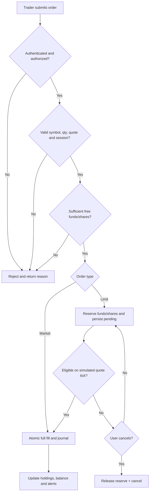
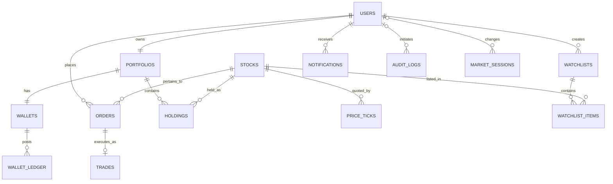
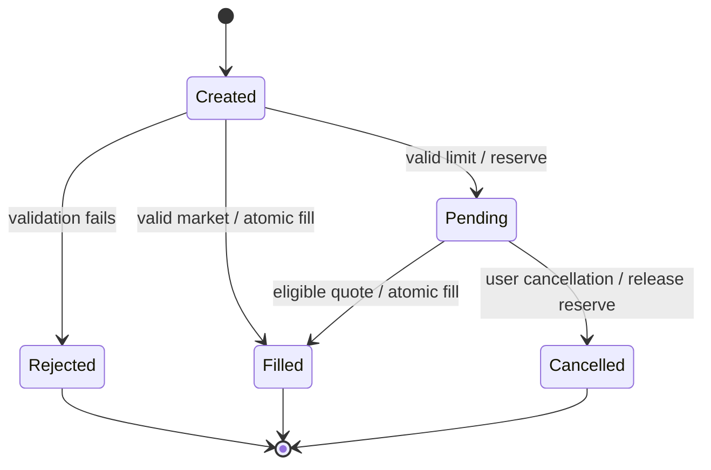
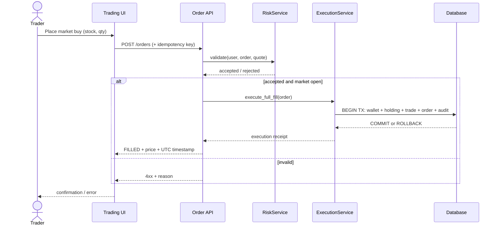

> **Implementation amendment (2026-11-16):** This file is the original planning baseline, preserved for context. The implemented contract is documented in [decision_log.md](decision_log.md), [as-built.md](as-built.md), [schema.md](schema.md), [openapi.json](openapi.json) and [traceability.csv](traceability.csv). Historical placeholders are reconciled in [placeholder_register.csv](placeholder_register.csv). The user explicitly excluded authoring experiment submissions: [lab-source-guide.md](lab-source-guide.md) supplies material for all 13. No Docker, deployment, student identities or invented sign-offs.

# TradeSphere — Diagram and Software Engineering Experiment Master Plan

> **Planning status:** diagrams are **specifications/drafts**, not final rendered UML. Replace draft node and message names with the actual implementation after gates G01–G07; close every placeholder in final P08. The 13 experiments are based on the teacher's uploaded **SE LIST OF EXPERIMENTS.pdf** (one-page list). Mermaid examples are supplied where useful; produce UML-standard diagrams in PlantUML/draw.io if required by teacher.

## 0. Diagram production rules
1. Use one name consistently: `Order`, `Trade`, `Wallet`, `Holding`, `Stock`, `PriceTick`, `MarketSession`, `AuditLog`.
2. Show external actors outside system boundary; do not draw a database as an actor.
3. DFDs show **data movements**, not execution-control arrows; each decomposition balances inputs/outputs with parent level.
4. ERD must match SQL migrations, including PK/FK, one-to-many, one-to-one, cardinalities and constraints.
5. State and sequence diagrams must honor full-fill-only synthetic execution; no partial fills or broker matching in MVP.
6. A communication/collaboration diagram is **not** the same as a sequence diagram: number the messages between collaborating objects.
7. Component diagram is logical; deployment diagram is physical execution nodes and connections.
8. Put titles, legend, project, diagram ID, version, date, author and source-of-truth commit on final images.
9. Every diagram has preconditions, scenario, postconditions, exceptions and links to US/FR/BR codes.
10. P07 drafts are validated with implementation; P08 removes unresolved placeholders from final submitted artifacts.

## 1. Complete inventory mapped to 13 experiments
| ID | Experiment | Required output | Referenced implementation | Final evidence / placeholder |
|---|---|---|---|---|
| D01 | E01 Problem Statement | Diagram optional: problem context/system boundary | idea.md §§1–2 | [DIAG-TBD-01] teacher template / objective |
| D02 | E02 SRS | System context, functional taxonomy and traceability matrix | FR-01..22, NFR-01..12 | [DIAG-TBD-02] final SRS pages/table |
| D03a | E03 DFD | Context (Level 0) | auth/orders/admin/quotes | [DIAG-TBD-03] input/output labels |
| D03b | E03 DFD | Level 1 decomposition | services + DB stores | [DIAG-TBD-04] process numbering |
| D03c | E03 DFD | Level 2: place order / execute & settle | P04, BR-04..15 | [DIAG-TBD-05] data-flow balancing review |
| D03d | E03 Structure Chart | Hierarchical functional module decomposition | technical architecture | [DIAG-TBD-06] actual function/module names |
| D04 | E04 ERD | Full normalized schema / relationship diagram | P01 DDL | [DIAG-TBD-07] columns, FK, cardinalities |
| D05 | E05 Use Case | Actors, main use cases, include/extend | US-01..14, FR | [DIAG-TBD-08] actor role decision |
| D06a | E06 Class | Domain + service classes, attributes/operations | SQLAlchemy/service classes | [DIAG-TBD-09] actual method names |
| D06b | E06 Object | Concrete demo instances at one timestamp | seeded DEMO scenario | [DIAG-TBD-10] actual IDs/values/time |
| D07a | E07 State Chart | `Order` life cycle | P04, status enum | [DIAG-TBD-11] rejection persistence choice |
| D07b | E07 Activity | Buy/limit order with guards, paths, swimlanes | P04 | [DIAG-TBD-12] API/DB boundaries |
| D08a | E08 Sequence | Market buy, limit fill, cancel flow | routes/services/DB | [DIAG-TBD-13] actual message signatures |
| D08b | E08 Collaboration/Communication | Numbered interactions for market buy | same objects as D08a | [DIAG-TBD-14] numbered message list |
| D09 | E09 Component | Modules, provided/required interfaces | server architecture | [DIAG-TBD-15] imported module names |
| D10 | E10 Deployment | Browser, web server, API, DB, optional worker | actual runtime | [DIAG-TBD-16] node hosting details |
| D11 | E11 Tests | Test-case table; optional test workflow diagram | executed pytest suites | [DIAG-TBD-17] result screenshots |
| D12 | E12 Function Points | EI/EO/EQ/ILF/EIF counted worksheet, formula | implemented APIs/functions | [DIAG-TBD-18] actual count/complexity |
| D13a | E13 Gantt | Activities vs calendar weeks + critical milestones | P00..P08 | [DIAG-TBD-19] dates/team owners |
| D13b | E13 PERT | Dependency network, 3-point estimates and critical path | tasks and gates | [DIAG-TBD-20] durations/critical path |

## 2. D03 — DFD specifications
### D03a: Context (Level 0)
**One process:** `(0) TradeSphere Virtual Trading System`. **External entities:** Trader; Admin; Market Operator; optional Price Tick Scheduler (if external to system — otherwise model internal process). **Trader -> System:** registration/login data, order details, watchlist changes, history queries. **System -> Trader:** auth result, quote/market data, order confirmations/rejections, portfolio, transaction history, notifications. **Admin -> System:** stock and user administration, audit search. **System -> Admin:** catalog confirmations, account summaries, audit report. **Market Operator -> System:** synthetic quote ticks, session open/close requests. **System -> Market Operator:** tick confirmation, session state, price history. **No data store in Level 0**, unless the faculty's notation explicitly expects it.

### D03b: Level 1
Processes: `(1.0) Manage Identity`, `(2.0) Maintain Market Data`, `(3.0) Manage Wallet`, `(4.0) Accept & Validate Orders`, `(5.0) Execute & Settle Trades`, `(6.0) Manage Portfolio & Watchlists`, `(7.0) Reports, Notifications & Audit`.

Data stores: `D1 Users`, `D2 Stocks & PriceTicks`, `D3 Portfolios & Holdings`, `D4 Wallets & Ledger`, `D5 Orders`, `D6 Trades`, `D7 Watchlists`, `D8 Notifications & Audit`, `D9 MarketSessions`.

**Balancing checklist:** every Trader/Admin/Market Operator request and response in context diagram appears crossing Level 1 boundary; internal process and data-store arrows are labeled with *data* (`Order Request`, `Quote Event`, `Execution Record`, `Balance Snapshot`) rather than `Trigger Worker`. Each process has at least one in/out flow. Detail exact DFD cardinalities in [DIAG-TBD-04].

### D03c: Level 2 for 4.0/5.0
- `4.1 Authenticate Owner` -> `4.2 Validate Symbol, Market and Quantity` -> `4.3 Check Risk/Available Funds/Shares` -> `4.4 Reserve Resources` -> `4.5 Create Order`.
- If valid market order: `5.1 Read Latest Quote` -> `5.2 Verify Eligible Order` -> `5.3 Execute Full Fill` -> `5.4 Post Wallet Ledger` -> `5.5 Update Holdings` -> `5.6 Persist Trade, Status, Audit, Notification`.
- If limit order: persist `PENDING`; an updated quote enters eligibility comparison before 5.3.
- Rejected order produces error/no funds movement; cancelled pending releases reservation and saves lifecycle transition.

### D03d: Structure chart
Top `TradeSphere Controller` -> `Identity Module`, `Market Module`, `Order Module`, `Settlement Module`, `Wallet Module`, `Portfolio Module`, `Reporting Module`, `Admin Module`. Break `Order Module` into Validate -> Risk -> Reserve -> Persist; `Settlement` into Eligibility -> Ledger -> Position -> Audit. **Label interfaces by data passed / return values; exact methods after P04.**

### D03 illustrative functional flow (NOT a formal DFD)

## 3. D04 — ERD and data dictionary
**Required entities:** User, Stock, PriceTick, MarketSession, Portfolio, Wallet, WalletLedger, Order, Trade, Holding, Watchlist, WatchlistItem, Notification, AuditLog. Refer to `technical.md` §4 for attributes.

**Expected relationships (confirm by DDL):**
- User 1:1 Portfolio; Portfolio 1:1 Wallet; Wallet 1:N WalletLedger.
- User 1:N Orders; Stock 1:N Orders; Order 1:0..1 Trade in full-fill MVP.
- Portfolio 1:N Holdings; Stock 1:N Holdings; compound unique (portfolio_id,stock_id).
- Stock 1:N PriceTicks; User 1:N Watchlists; Watchlist 1:N WatchlistItems; Stock 1:N WatchlistItems.
- User 1:N Notifications; User 1:N AuditLog as actor (nullable for system events).
- MarketSession historical table controlled by MARKET_OPERATOR; operator FK may be nullable for seeded session.

### ERD draft (relationship skeleton)

**Warning:** Diagram notation/cardinalities are drafts. If application supports users without portfolios, or deletes are restricted, document optional participation and align entities. Final ERD must display PK/FK and field types, not only this skeleton.

## 4. D05 — Use Case diagram
**Actors:** Trader, Administrator, Market Operator, optional System Scheduler. **Boundary:** TradeSphere. **Trader cases:** Register/Login, View Stocks, View Quote History, Place Market Order, Place Limit Order, Cancel Pending Order, View Wallet, View Holdings & P&L, View Transaction History, Manage Watchlist, Read Notifications. **Admin cases:** Manage Stocks, Manage Users, Search Audit Trail, View Order Summary. **Market Operator cases:** Update Simulated Price, Open/Close Market, Review Price History. **Scheduler:** Produce Tick (only if implemented). `Place Order` **includes** Authenticate, Validate Risk and Check Market; `Fill Limit Order` is an internal system outcome, not necessarily a human-initiated use case. Include/extend use sparingly.
**[DIAG-TBD-08]** Three-role separation is RESOLVED; confirm only any actual external-system actors after implementation.

## 5. D06a/D06b — Class and Object diagrams
**Class candidates and responsibilities:**
- `User(id,email,role)` -> `register`, `authenticate` (often AuthService handles actions).
- `Stock(id,symbol,active)` -> `get_latest_quote` via MarketService.
- `Order(id,side,type,qty,status,reserve)` -> `validate_transition`, `cancel` via OrderService.
- `Trade(id,price,qty,executed_at)` -> immutable data record.
- `Wallet(cash_total,reserved_cash)` -> `available_cash`.
- `Holding(qty,reserved_qty,avg_cost)` -> `available_qty`, `update_on_buy/sell`.
- `Portfolio(user_id)` -> `compute_market_value`, `compute_unrealized_pnl`.
- `RiskService` -> `validate_buy/sell`; `ExecutionService` -> `execute_eligible`; `AuditService` -> `record_event`.

**Object diagram reference snapshot:** `traderA:User`, `portfolioA:Portfolio`, `walletA:Wallet`, `demoStock:Stock`, `buy001:Order`, `trade001:Trade`, `holdingA:Holding` with seed values from idea.md demo. **[DIAG-TBD-10]** Replace placeholders with actual test database IDs, specific timestamp, exact wallet and holding values after P04. Object diagram = instances and current links, not UML classes repeated.

## 6. D07 — State chart + activity

**State invariant:** no `PartiallyFilled` for MVP. If failed execution causes DB rollback, order remains PENDING or request fails; it must not become FILLED without a trade. **[DIAG-TBD-11]** Determine whether Rejected is persisted state.

**Activity diagram swimlanes:** Trader -> Frontend -> Order API -> Risk -> Wallet/Holdings -> Execution -> Persistence -> Notifications. Decisions: authenticated?, market open?, qty valid?, funds/shares available?, market vs limit?, quote condition met?, cancelled? Include both success and exception paths. **[DIAG-TBD-12]** map final methods/transactions.

## 7. D08 — Sequence + Collaboration diagrams
### Sequence A: Market buy (draft)

### Sequence B: Limit trigger
`MarketOperator -> Operator API: post tick` -> `MarketService: append quote` -> `ExecutionService: query pending` -> `Risk/OrderService: verify status` -> `DB: transaction (reservation release, wallet, holding, trade, status, audit)` -> `NotificationService` -> `Trader: query status`.

### Sequence C: Cancel
`Trader -> OrderAPI: cancel` -> `Auth: verify owner` -> `OrderService: verify PENDING` -> `DB: release reserved money/shares and mark CANCELLED atomically` -> `NotificationService` -> `Trader: confirmation`. Alternative already FILLED -> 409 conflict.

### Collaboration / Communication diagram
Objects: `trader`, `ui`, `orderController`, `riskService`, `executionService`, `db`. Number messages `1:placeOrder`, `1.1:POST /orders`, `1.2:validate`, `1.3:execute`, `1.3.1:BEGIN`, `1.3.2:insertTrade`, `1.3.3:updateWallet`, `1.3.4:updateHolding`, `1.3.5:COMMIT`, `1.4:response`, `2:renderReceipt`. Numbers must agree with the final code sequence and include failure path. **[DIAG-TBD-14]** lock exact method signatures during P07.

## 8. D09 — Component diagram
**Required components:** Browser React App (UI and API client), FastAPI REST Controllers, Authentication, Market Data, Order Management, Risk Validation, Execution/Settlement, Wallet/Ledger, Portfolio/Reporting, Notifications/Audit, SQLAlchemy Repositories, relational DB; optional Tick Scheduler in same process. Show arrows for dependency and label interfaces (`IOrders`, `IMarketData`, `IWallet`, `IAudit`, `IRepository`) only if interfaces actually exist. **[DIAG-TBD-15]** resolve exact deployed Python package and module names.

## 9. D10 — Deployment diagram
**Physical nodes for local prototype:** `[Trader browser]`, `[Admin browser]`, `[Market Operator browser]` -> HTTP to `[Development machine: React dev server or static web bundle]` -> HTTP to `[Development machine: FastAPI process]` -> TCP to `[PostgreSQL database server/process]` (can run on the same machine or Docker Compose). Optional tick scheduler is co-located with backend. Show browser, API and Postgres as distinct execution environments; do not invent cloud servers. Mark TLS/HTTPS only if configured. **[DIAG-TBD-16]** update host, ports, OS/runtime versions after deployment.

## 10. D11 — Unit and integration testing experiment
**Unit suites:** order validity boundary, decimal calculations, average-cost P&L, market/limit eligibility, state transition matrix, reservations and release. **Integration suites:** registration wallet initialization, POST order -> DB trade, quote tick -> limit fill, cancel -> reserved balance release, authorization isolation, duplicate idempotency, forced settlement rollback, persisted audit. **Template columns:** test ID, requirement ID, method/input, initial DB state, expected result, actual result, status, tester, run date, commit hash, screenshot/log evidence. 

**[DIAG-TBD-17]** Replace all `planned` statuses with observed results. Zero invented pass counts.

## 11. D12 — Function Point (FP) estimation experiment
Use standard **unadjusted function points (UFP)** classification with EI, EO, EQ, ILF, EIF. Classify from **user-recognizable functions and logical data groups**, *not* merely raw endpoint or physical table counts. 

**Candidate EIs:** register user, login/session, create order, cancel order, add/remove watchlist symbol, admin create/update stock, market operator quote tick, market session change, notification read update.
**Candidate EOs:** portfolio P&L summary, transaction reports, analytics dashboard, alerts/report outputs.
**Candidate EQs:** stock search/latest quote, order lookup, ledger query, watchlist lookup, trade-history lookup.
**Candidate ILFs:** user/account data, market catalog+quotes, wallet/ledger, orders+trades, portfolio/holdings, watchlists, alerts/audit (group boundaries must be justified by business ownership).
**Candidate EIFs:** **zero** if no external maintained interface is used; do not invent an external market feed.

**Worksheet template:**
| Function ID | Function | Type (EI/EO/EQ/ILF/EIF) | DET | FTR / RET | Complexity (Low/Avg/High) | Weight | Weighted FP | Evidence |
|---|---|---|---|---|---|---|---|---|
| FP-001 | Create order | EI | [TBD] | [TBD] | [TBD] | [TBD] | [TBD] | FR-08/09 |
| FP-002 | Portfolio summary | EO | [TBD] | [TBD] | [TBD] | [TBD] | [TBD] | FR-15/18 |

Typical IFPUG unadjusted weights (if mandated): EI 3/4/6; EO 4/5/7; EQ 3/4/6; ILF 7/10/15; EIF 5/7/10 (low/average/high). **UFP = sum(count × applicable weight)**. If faculty requires adjusted FP, document value adjustment factor and GSCs; do not assume VAF without source requirements. **[DIAG-TBD-18]** count after implemented scope frozen; attach DET/FTR/RET reasoning.

## 12. D13 — Gantt and PERT
**Gantt tasks:** P00 scope, P01 scaffolding+PostgreSQL, P02 auth/wallet, P03 market/operator, P04 trading engine, P05 portfolio/reporting, P06 UI integration, P07 QA/experiments/rehearsal, P08 as-built closure. Show actual dates/start/end only once known, along with owners and dependencies. Some UI work can overlap earlier APIs; E01–E13 diagrams are drafted throughout, finalized after QA.

**PERT:** for each task record optimistic `a`, most likely `m`, pessimistic `b`; expected `te=(a+4m+b)/6`; variance `((b-a)/6)^2`. Dependency network must represent P02 and P03 both feeding P04; P05 after P04; P06 after stable backend; E01–E13 drafts may start after P01 but final evidence is due at G07; final placeholder gate G08 follows G07. Calculate earliest/latest starts, float and critical path only after estimates are known. **Never invent dates to make a pretty graph.** [DIAG-TBD-19], [DIAG-TBD-20].

## 13. Cross-check: every SE experiment is satisfied only when ...
| E | Minimum acceptance evidence |
|---|---|
| E01 | Specific problem statement, objective, actors, scope and boundaries |
| E02 | Full SRS FR/NFR, assumptions, acceptance, glossary, requirement traceability |
| E03 | Balanced context/Level1/Level2 DFDs and structure chart |
| E04 | ERD with final schema attributes, PK/FK, relationships, keys and data dictionary |
| E05 | Correct use-case actors, boundary, functionality |
| E06 | Code-aligned class diagram and populated object-instance diagram |
| E07 | State machine and guarded activity workflow incl rejection/cancellation |
| E08 | Sequence and separately numbered communication/collaboration diagrams |
| E09 | Logical component dependencies, interfaces and owned modules |
| E10 | Actual physical deployment nodes and runtimes, no imaginary servers |
| E11 | Real executed unit/integration result evidence, not just test plan |
| E12 | Traceable function counts and explained complexity weights |
| E13 | Calendar Gantt, dependency PERT, 3-point task estimates and critical path |

## 14. Placeholder closure registry (mandatory P08)
All known placeholders in this file: `[DIAG-TBD-01]` through `[DIAG-TBD-20]`. Also search `technical.md` for `[SCHEMA-TBD-*]`, `[API-TBD-*]`, `[UI-TBD-*]`, `[TECH-TBD-*]`, `[TEST-TBD-*]`, `[STATE-TBD-*]`; `implementation.md` for `[PLAN-TBD-*]`, `[LAB-TBD-*]`; `idea.md` for `[OPEN-*]`. Final closure report records for each **ID, owner, resolution (filled/deferred), evidence file/commit, review date**. Do not erase historical open-decision register: mark it **RESOLVED** with evidence. Do not claim deferred optional features exist.

## 15. Locked role and persistence amendments (baseline v1.1)
- All relevant DFDs/use cases/sequence/activity diagrams show **three independent human actors**: TRADER, ADMIN, MARKET_OPERATOR. Admin handles catalog/governance/audit; operator handles synthetic ticks/session. A system tick scheduler is an internal subsystem unless deployed as a separate outside producer.
- In D08b show actor `marketOperator` initiating `/operator/ticks` for the limit-fill scenario. The trader initiates order placement/cancellation.
- E04/D04 is sourced from the **PostgreSQL** schema migrations, including NUMERIC precision, TZ-aware timestamp and unique idempotency/trade constraints.
- E10/D10 represents PostgreSQL server/process, not a SQLite file; actual host, port and container setup remain `[DIAG-TBD-16]` until deployment.
- E13 does **not** require fabricated calendar dates. For the submitted Gantt, use actual phase dates once worked and clearly distinguish planned vs actual. No teacher deadline has been supplied.
- Gate/phase references are now `P00–P08`, `G00–G08`; **P08** performs mandatory final diagram and placeholder closure.
