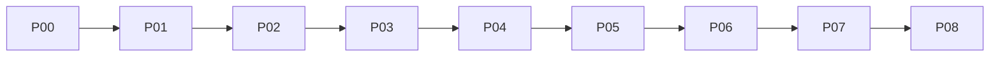

> **Implementation amendment (2026-11-16):** This file is the original planning baseline, preserved for context. The implemented contract is documented in [decision_log.md](decision_log.md), [as-built.md](as-built.md), [schema.md](schema.md), [openapi.json](openapi.json) and [traceability.csv](traceability.csv). Historical placeholders are reconciled in [placeholder_register.csv](placeholder_register.csv). The user explicitly excluded authoring experiment submissions: [lab-source-guide.md](lab-source-guide.md) supplies material for all 13. No Docker, deployment, student identities or invented sign-offs.

# TradeSphere — Nine-Phase Implementation Roadmap and Quality Gates

> **Planning baseline v1.1 (2026-11-16).** Project: Level 2 simulated trading ecosystem. Database: **PostgreSQL**; quotes: **synthetic only**; distinct roles: **TRADER, ADMIN, MARKET_OPERATOR**; **no fixed deadline**. These are 9 sequentially numbered milestones P00–P08, not 9 weeks. Three teammates may execute independent steps in parallel. Only demonstrated and recorded evidence passes a gate.

## How to run the plan
- `Pxx` is a phase; `Gxx` is its exit gate. Gate failures block dependent work until corrected or explicitly risk-accepted in `docs/decision_log.md`.
- Maintain `docs/traceability.csv` linking `US` → `FR` → API/service → table → tests → `D` diagram → evidence. Never mark planned tests as passed.
- Roles for *team members* are distinct from *application roles*: Member A (database/backend/auth), Member B (trading engine/risk/testing), Member C (React/dashboard/docs). Every gate needs at least one cross-reviewer.
- `docs/phase_evidence/Pxx/` must contain README/checklist, git revision, test output, relevant screenshots/screenshare notes and open issues. Use screenshots of synthetic data only.
- Shared prerequisites: Python/Node/PostgreSQL locally or via Docker, Git, reproducible dev credentials, teacher's experiment list, and explicit educational-paper-trading disclaimer.

## Dependency map

The strict gate chain applies to *release readiness*; frontend mockups, test design, and draft E01–E13 diagrams can be prepared earlier. No calendar week count is assumed.

| Phase | Purpose | Blocking prerequisites | Gate | Major evidence |
|---|---|---|---|---|
| P00 | Requirements, three-role permissions, plan and choices | Teacher list, agreement | G00 | Scope+decision register |
| P01 | Repository, runtime, PostgreSQL and migrations | G00 | G01 | Clean startup + schema migration |
| P02 | Three-role auth, wallet, seed and relational baseline | G01 | G02 | RBAC and wallet tests |
| P03 | Market catalog, synthetic ticks and sessions | G02 | G03 | Operator-only tick/session demo |
| P04 | Buy/sell engine, reservations, limit triggers, cancellation | G02+G03 | G04 | Atomic-trading test suite |
| P05 | Portfolio, P&L, watchlists, alerts, reports | G04 | G05 | Arithmetic and API checks |
| P06 | UI and end-to-end integrated demo | G02–G05 | G06 | All three roles in UI |
| P07 | Quality hardening, full SE deliverables E01–E13, rehearsal | G06 | G07 | Passing tests, diagrams, FP, Gantt/PERT |
| P08 | **Mandatory placeholder resolution, as-built reconciliation and final package** | G07 | G08 | Zero unresolved as-built placeholders |

## P00 — Scope and decisions
**Prerequisites:** read `idea.md`, `technical.md`, `flowcharts.md`, teacher's experiment sheet; identify the three teammates.
1. Confirm locked decisions: PostgreSQL; synthetic operator-controlled/scripted ticks; three distinct authenticated roles; no calendar deadline.
2. Assign scope to MVP (F01–F11, US-01–US-14, FR-01–FR-22) versus deferred options. Keep full fills only; no real exchange, no user-to-user matching.
3. Sign off access matrix: TRADER only own financial data; ADMIN only governance/stocks/audit; MARKET_OPERATOR only market ticks and sessions. Resolve or assign [RBAC-TBD-01].
4. Choose working defaults or record decisions for remaining `[OPEN-*]`: fees, starting balance, order maximums, frontend, auth, rejection persistence, quote scheduling.
5. Create issue board, owners, project Definition of Done, risk/assumption logs, initial requirements traceability matrix, tentative demo script.
6. Draft E01 and E02 and inventory the other diagrams; record teacher-specific presentation conventions as `[LAB-TBD-01]`.
**Gate G00:** Three teammates agree to documented MVP and roles; database and price source unambiguous; every FR has owner and acceptance test outline. **Evidence:** signed scope/decision log, initial SRS, backlog. **Stop if:** any role can secretly perform another role's mutation or trading semantics are undefined.

## P01 — Repository, PostgreSQL, schema and API scaffolding
**Prerequisite:** G00; PostgreSQL server/connectivity available.
1. Create monorepo `backend/`, `frontend/`, `docs/`, `tests/` with env examples, lint/formatter/test commands and dependency pinning.
2. Implement FastAPI `/health`, OpenAPI v1, global error format, CORS development policy; scaffold Vite/React/Tailwind and typed API client.
3. Configure SQLAlchemy engine and session lifecycle against PostgreSQL URL, Alembic migration chain, decimal precision, UTC timestamps, FK/unique/check constraints.
4. Implement schema from `technical.md`: users, stocks, price_ticks, market_sessions, portfolios, wallets, wallet_ledger, orders, trades, holdings, watchlists/items, notifications, audit_logs.
5. Choose PostgreSQL isolation (default `READ COMMITTED`), deterministic lock ordering, row locks for atomic operations; add idempotency index and `trades.order_id UNIQUE`.
6. Write clean-DB migration up/down smoke tests; seed fictional symbols and reproducible quotes (privileged accounts in next phase).
7. Draft real ERD and component structure from migration and modules; document actual Postgres version and migration ID as [SCHEMA-TBD-01] evidence.
**Gate G01:** Clean clone starts UI/API and PostgreSQL; migration/rollback/reapply tests pass; DB constraints verified; `/health` returns OK; source contains no secrets. **Evidence:** command log, migration revision, schema screenshot, initial D04. **Stop if:** DB choice silently falls back to SQLite or schema constraints do not apply.

## P02 — Authentication, RBAC and virtual wallet
**Prerequisite:** G01, decided auth transport and role seed mechanism.
1. Build registration/login/logout/profile with modern password hashing; new public registrations always get `TRADER` role.
2. Seed ADMIN and MARKET_OPERATOR through controlled script/config, never public registration; use distinct credentials.
3. Implement role dependency and owner checks; explicit forbidden cases for all three roles; privileged endpoints not interchangeable.
4. Initialize one portfolio/wallet and ₹100,000 initial simulated credit (change only via OPEN-09 decision) atomically once per registered trader.
5. Implement `/wallet`, `/wallet/ledger`, reserved/available calculations; wallet event log consistent with cash_total.
6. Integration tests: duplicate email, repeated registration calls, login, access matrix, trader A accessing B data, one-time credits.
**Gate G02:** Three role identities authenticate; Trader/Admin/Market Operator cross-role tests return expected 403; one-time starting funds and ledger reconcile; separate accounts cannot read each other's trading data. **Evidence:** auth test logs, role matrix screenshots, ledger sample. **Stop if:** privileged roles are exposed at registration or wallet credits duplicate.

## P03 — Synthetic market and operator console API
**Prerequisite:** G02, quote precision and session behavior chosen.
1. ADMIN only: create/update/disable stock symbol metadata and view catalog; add stock uniqueness/positive values checks.
2. MARKET_OPERATOR only: publish tick with source `SIMULATED`, positive Decimal price, UTC timestamp, previous-tick history; provide deterministic scripted tick scenarios.
3. MARKET_OPERATOR only: open/close simulated market; store actor/timestamp/audit event.
4. Authenticated users can browse stocks/prices/session status. Quote freshness policy explicit; no external market API.
5. Add operator endpoints `/operator/ticks`, `/operator/market-session`, `/operator/market-status`; add backend hook for order trigger (implemented P04).
6. Test unauthorized admin tick and unauthorized operator stock mutation, invalid ticks, clock consistency, closed-session behavior, idempotent scripted tick run.
**Gate G03:** Admin manages symbols but cannot publish ticks; operator publishes synthetic ticks but cannot alter catalog; traders can see quote history and session; role-negative tests pass. **Evidence:** API sample requests, persistent tick rows, role tests. **Stop if:** role separation does not hold.

## P04 — Trading engine, risk and atomic settlement (critical gate)
**Prerequisite:** G02 + G03; finalized money, cost basis and order policy.
1. Implement `POST /orders`, `GET /orders`, `POST /orders/{id}/cancel` with idempotency key and user ownership.
2. Risk checks: positive whole shares, enabled symbol, market open where needed, quote not stale, maximum order size, sufficient **available** cash or **unreserved** shares; deterministic rounding.
3. Market buy/sell full-fill only at current synthetic quote. Single PostgreSQL transaction writes order, trade, wallet ledger, holdings, audit and notification.
4. Limit buy: reserve `qty×limit`; limit sell: reserve shares; create PENDING. On operator tick, fill eligible orders at quote (not worse than limit) and release remaining reservation.
5. Cancellation locks order/wallet/holding under consistent lock order; releases reserves exactly once; FILLED cannot be cancelled.
6. Use PostgreSQL `SELECT ... FOR UPDATE` for affected rows, uniqueness for idempotency, status recheck under lock, bounded retry on deadlocks; investigate race tests under concurrent request load.
7. Verify market closed, price exactly at limit, duplicate HTTP request, repeated tick, simultaneous cancel/fill, forced DB rollback, oversell, negative balance prevention.
8. Seed and run canonical demo: buy 10 @100, limit buy 5 @95, sell 3 @110 with known timestamps and expected P&L.
**Gate G04:** All money/order consistency tests pass; no duplicate debit/fill; settlement rollback verified; no negative available balances or holdings; saved execution records have exact quantity/price/time. **Evidence:** integration test logs, SQL audit, G04 demo capture. **Stop if:** *any* settlement invariant fails.

## P05 — Portfolio, watchlists, alerts and analytics
**Prerequisite:** G04 and agreed realized-P&L cost basis.
1. Implement portfolio holdings (qty, reserved qty, weighted average cost), unrealized and realized P&L, portfolio equity and mark timestamp.
2. Add own order/trade filters, timestamped wallet ledger, market history and portfolio basic charts/statistics.
3. Implement owned watchlists/watchlist items and duplicate prevention.
4. Persist in-app execution/cancel/rejection notifications and read/unread state; ADMIN sees sanitized audit report and aggregate order data, not other users' raw private credentials.
5. Test P&L arithmetic using fixed synthetic quotes, position after multiple buys/sells, totals vs ledger, watchlist scope, notifications created exactly once.
**Gate G05:** Deterministic P&L matches independent expected-value tests; histories/watchlists are owner-scoped; alerts and audit persist. **Evidence:** report JSON, test snapshots, traceability update. **Stop if:** portfolio equity double-counts reservations.

## P06 — React interface and end-to-end demonstration
**Prerequisite:** G02–G05 stable routes; mock screens may start at P01.
1. Build login/signup, role-aware route navigation, synthetic-money disclaimer on every trading page, clear pending/filled/cancelled labels.
2. Trader screens: market and charts, order ticket, order list/cancel, wallet/history, holdings/P&L, watchlist and alerts.
3. Admin screens: stock catalog/user directory, sanitized audit and aggregate statistics; **no** tick/session mutation controls.
4. Market Operator screens: publish quote, deterministic scenario run, market open/closed controls, tick history; **no** symbol/user management controls.
5. Integrate response/error handling, loading/empty states, accessible forms, UTC storage and Asia/Kolkata UI display.
6. E2E demo: three accounts sign in, admin creates stock, operator opens market/publishes tick, trader buys/places limit, operator moves price, trader sees automatic fill and P&L, admin sees audit.
**Gate G06:** Full seeded demo works through browser with no direct DB edits; role navigation and forbidden API cases correct; no page claims real market quotes or money. **Evidence:** screenshots/video, scenario walkthrough, network log. **Stop if:** the three-role journey is untestable.

## P07 — Verification, SE experiments E01–E13 and release rehearsal
**Prerequisite:** G06 (draft experiments permitted earlier); PostgreSQL repeatable tests and traceability established.
1. Run complete unit, API, integration, permission and concurrency suites; forced settlement rollback; clean migration/reset/seed; capture observed pass/fail with exact commit.
2. Security pass: role/ownership/CSRF or token storage, no secrets, reasonable rate limiting, error responses, SQL constraints; measure local p95 target and document actual outcome.
3. Produce E01 problem statement; E02 SRS with FR/NFR; E03 context/level1/level2 DFD + structure chart; E04 ERD matching migrations; E05 use cases for all 3 roles.
4. Produce E06 class+object; E07 order state+activity; E08 sequence+communication; E09 logical components; E10 as-deployed browsers/API/Postgres; E11 executed unit+integration tables.
5. Calculate E12 unadjusted FP with EI/EO/EQ/ILF/EIF and justified DET/FTR/RET, no invented EIF; optionally adjusted FP only if required.
6. Produce E13 Gantt/PERT using real task efforts/dependencies, three-point estimates and critical path; **no invented deadline**. Calendar dates remain `[DIAG-TBD-19]` until actual dates recorded.
7. Verify consistency: every FR maps to implemented routes/tests or is explicitly deferred; all diagrams show operator tick endpoint and distinct ADMIN and MARKET_OPERATOR.
8. Rehearse from clean clone and seed; identify any high-priority issues and re-run impacted tests.
**Gate G07:** All 13 lab outputs reviewable and grounded; critical functional/security tests pass with logged evidence; user flow runs; no misleading unimplemented claims. **Evidence:** `/docs/experiments/E01...E13`, tests report, FP calculation, demo checklist. **Stop if:** any lab diagram contradicts implementation or tests are only planned.

## P08 — Mandatory final placeholder closure and as-built reconciliation
**Prerequisite:** G07. This is the **last phase and is required** even if all earlier steps succeed.
1. Search code and docs for `TBD`, `[OPEN-`, `-TBD-`, `[PLACEHOLDER`, `TODO`, `UNVERIFIED`, `PENDING DECISION`; capture to `docs/placeholder_register.csv` with ID, owner, status, evidence/commit, resolution date.
2. Resolve every remaining design/API/database/diagram detail from actual code and migrations; where functionality is deferred, label **OUT OF MVP / NOT IMPLEMENTED** and remove it from as-built diagrams and implemented SRS claims.
3. Update `idea.md`, `technical.md`, `implementation.md`, `flowcharts.md`, README, SRS, all 13 outputs, screenshots, cost calculations, deployment nodes, and CI/test evidence to the same release commit.
4. Fill `[DIAG-TBD-01..20]` individually with actual context, actor names, module names, database constraints, method signatures, task evidence, FP counts and PERT calculations. Keep historical `OPEN` decisions marked RESOLVED; only unresolved entries must be closed or transparently deferred.
5. Check no SQLite, external price API or two-role architecture remains accidentally described as the implemented default; verify three role accounts, PostgreSQL schema, synthetic quotes across docs/test/demo.
6. Final full regression test, migrate from scratch, seed, execute demo, export final diagrams and reports, tag release and perform independent teammate sign-off.
**Gate G08 — FINAL:** **Zero unresolved placeholders in documents presented as as-built**, with explicitly deferred features clearly separated; all 13 experiments match release tag, real test logs and PostgreSQL deployment. **Evidence:** placeholder closure report, git tag/commit, schema revision, test output, signed review, demo recording.

## Risk register and priorities
| Risk | Severity | Trigger | Mitigation |
|---|---|---|---|
| Double debit / race in order fill | Critical | concurrent tick/cancel/retry | PostgreSQL locks, uniqueness, transactional ledger and concurrency tests |
| Permission leakage across three roles | Critical | operator changing catalog, admin posting ticks, trader using privileged API | per-route RBAC matrix and forbidden-case tests |
| Synthetic price confusion | High | UI/diagram implies exchange feed | source label in quote records, UI and SRS; no network dependency |
| Overambitious scope | High | three-person team cannot finish full ecosystem | defer social/prediction/partial fills; preserve G04 money-safe engine |
| Wrong financial arithmetic | High | P&L disagrees with ledger | deterministic seed and independently computed fixtures |
| Document drift | High | ERD/UML/FP differs from schema | start drafts early, review at G07 and close at G08 |
| PostgreSQL setup friction | Medium | teammate cannot reproduce DB | Docker Compose option, migration health check, `.env.example` |
| Dates/owners unknown | Medium | Gantt cannot be calendared | record actual start/end during build; no fabricated submission date |

## Work-start checklist
- Read `README.md` and `idea.md`; record unresolved OPEN IDs without hiding them.
- Assign actual team members A/B/C; decide on task board and exact development machine setup.
- Install PostgreSQL and verify shared local/CI connectivity.
- Use the nine gates as the single source of truth for code/demo/diagram readiness.
