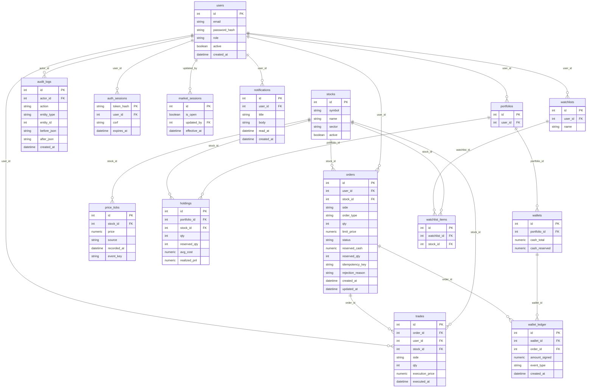

# Implemented PostgreSQL schema

Revision: 0001. Generated from actual ORM mapping. Numeric values are fixed precision; timestamps are timezone-aware. See migration for the frozen DDL.

## stocks

| Field | Type | Nullable | Key / references |
|---|---|---|---|
| id | INTEGER | False | PK |
| symbol | VARCHAR(16) | False |  |
| name | VARCHAR(100) | False |  |
| sector | VARCHAR(100) | False |  |
| active | BOOLEAN | False |  |

- UNIQUE (symbol)

## users

| Field | Type | Nullable | Key / references |
|---|---|---|---|
| id | INTEGER | False | PK |
| email | VARCHAR(254) | False |  |
| password_hash | VARCHAR | False |  |
| role | VARCHAR(24) | False |  |
| active | BOOLEAN | False |  |
| created_at | TIMESTAMP WITH TIME ZONE | False |  |

- UNIQUE (email)
- CHECK role IN ('TRADER','ADMIN','MARKET_OPERATOR')

## audit_logs

| Field | Type | Nullable | Key / references |
|---|---|---|---|
| id | INTEGER | False | PK |
| actor_id | INTEGER | True | FK users.id |
| action | VARCHAR | False |  |
| entity_type | VARCHAR | False |  |
| entity_id | INTEGER | True |  |
| before_json | JSON | False |  |
| after_json | JSON | False |  |
| created_at | TIMESTAMP WITH TIME ZONE | False |  |

## auth_sessions

| Field | Type | Nullable | Key / references |
|---|---|---|---|
| token_hash | VARCHAR(64) | False | PK |
| user_id | INTEGER | False | FK users.id |
| csrf | VARCHAR | False |  |
| expires_at | TIMESTAMP WITH TIME ZONE | False |  |

## market_sessions

| Field | Type | Nullable | Key / references |
|---|---|---|---|
| id | INTEGER | False | PK |
| is_open | BOOLEAN | False |  |
| updated_by | INTEGER | True | FK users.id |
| effective_at | TIMESTAMP WITH TIME ZONE | False |  |

## notifications

| Field | Type | Nullable | Key / references |
|---|---|---|---|
| id | INTEGER | False | PK |
| user_id | INTEGER | False | FK users.id |
| title | VARCHAR | False |  |
| body | VARCHAR | False |  |
| read_at | TIMESTAMP WITH TIME ZONE | True |  |
| created_at | TIMESTAMP WITH TIME ZONE | False |  |

## orders

| Field | Type | Nullable | Key / references |
|---|---|---|---|
| id | INTEGER | False | PK |
| user_id | INTEGER | False | FK users.id |
| stock_id | INTEGER | False | FK stocks.id |
| side | VARCHAR | False |  |
| order_type | VARCHAR | False |  |
| qty | INTEGER | False |  |
| limit_price | NUMERIC(18, 4) | True |  |
| status | VARCHAR | False |  |
| reserved_cash | NUMERIC(24, 4) | False |  |
| reserved_qty | INTEGER | False |  |
| idempotency_key | VARCHAR | False |  |
| rejection_reason | VARCHAR | True |  |
| created_at | TIMESTAMP WITH TIME ZONE | False |  |
| updated_at | TIMESTAMP WITH TIME ZONE | False |  |

- UNIQUE (user_id, idempotency_key)
- CHECK qty > 0
- CHECK status IN ('PENDING','FILLED','CANCELLED','REJECTED')
- CHECK side IN ('BUY','SELL')
- CHECK order_type IN ('MARKET','LIMIT')

## portfolios

| Field | Type | Nullable | Key / references |
|---|---|---|---|
| id | INTEGER | False | PK |
| user_id | INTEGER | False | FK users.id |

- UNIQUE (user_id)

## price_ticks

| Field | Type | Nullable | Key / references |
|---|---|---|---|
| id | INTEGER | False | PK |
| stock_id | INTEGER | False | FK stocks.id |
| price | NUMERIC(18, 4) | False |  |
| source | VARCHAR | False |  |
| recorded_at | TIMESTAMP WITH TIME ZONE | False |  |
| event_key | VARCHAR | True |  |

- UNIQUE (event_key)
- CHECK price > 0

## watchlists

| Field | Type | Nullable | Key / references |
|---|---|---|---|
| id | INTEGER | False | PK |
| user_id | INTEGER | False | FK users.id |
| name | VARCHAR(80) | False |  |

## holdings

| Field | Type | Nullable | Key / references |
|---|---|---|---|
| id | INTEGER | False | PK |
| portfolio_id | INTEGER | False | FK portfolios.id |
| stock_id | INTEGER | False | FK stocks.id |
| qty | INTEGER | False |  |
| reserved_qty | INTEGER | False |  |
| avg_cost | NUMERIC(24, 8) | False |  |
| realized_pnl | NUMERIC(24, 8) | False |  |

- UNIQUE (portfolio_id, stock_id)
- CHECK qty >= reserved_qty AND reserved_qty >= 0

## trades

| Field | Type | Nullable | Key / references |
|---|---|---|---|
| id | INTEGER | False | PK |
| order_id | INTEGER | False | FK orders.id |
| user_id | INTEGER | False | FK users.id |
| stock_id | INTEGER | False | FK stocks.id |
| side | VARCHAR | False |  |
| qty | INTEGER | False |  |
| execution_price | NUMERIC(18, 4) | False |  |
| executed_at | TIMESTAMP WITH TIME ZONE | False |  |

- UNIQUE (order_id)

## wallets

| Field | Type | Nullable | Key / references |
|---|---|---|---|
| id | INTEGER | False | PK |
| portfolio_id | INTEGER | False | FK portfolios.id |
| cash_total | NUMERIC(24, 4) | False |  |
| cash_reserved | NUMERIC(24, 4) | False |  |

- CHECK cash_total >= cash_reserved AND cash_reserved >= 0
- UNIQUE (portfolio_id)

## watchlist_items

| Field | Type | Nullable | Key / references |
|---|---|---|---|
| id | INTEGER | False | PK |
| watchlist_id | INTEGER | False | FK watchlists.id |
| stock_id | INTEGER | False | FK stocks.id |

- UNIQUE (watchlist_id, stock_id)

## wallet_ledger

| Field | Type | Nullable | Key / references |
|---|---|---|---|
| id | INTEGER | False | PK |
| wallet_id | INTEGER | False | FK wallets.id |
| order_id | INTEGER | True | FK orders.id |
| amount_signed | NUMERIC(24, 4) | False |  |
| event_type | VARCHAR | False |  |
| created_at | TIMESTAMP WITH TIME ZONE | False |  |

## Entity relationships

The generated FK graph shows parent references, not every unique participation rule. User -> portfolio and portfolio -> wallet are unique (0..1 globally); order -> trade is 0..1 by unique order_id. Consult UNIQUE constraints above when drawing the final conceptual ERD.